<style>
  @page {
    size: A4;
    margin: 18mm 16mm;
  }

  body {
    font-family: -apple-system, BlinkMacSystemFont, "Segoe UI", Roboto, Helvetica, Arial, sans-serif;
    font-size: 9.5pt;
    line-height: 1.55;
    color: #1e293b;
    background: #ffffff;
  }

  h1 {
    font-size: 18pt;
    font-weight: 800;
    color: #1e3a8a;
    margin: 0 0 14px 0;
    padding-bottom: 10px;
    position: relative;
  }

  h2 {
    font-size: 12.5pt;
    font-weight: 700;
    color: #1e3a8a;
    margin: 22px 0 8px 0;
    padding-bottom: 4px;
    border-bottom: 1px solid #e2e8f0;
    break-after: avoid;
  }

  h3 {
    font-size: 10.5pt;
    font-weight: 700;
    color: #14532d;
    margin: 14px 0 6px 0;
    break-after: avoid;
  }

  p {
    margin: 0 0 10px 0;
  }

  ul, ol {
    margin: 0 0 10px 0;
    padding-left: 20px;
  }

  li {
    margin-bottom: 4px;
  }

code,
  .markdown-body code {
    font-family: ui-monospace, SFMono-Regular, Menlo, Monaco, Consolas, monospace !important;
    font-size: 8pt !important;
    line-height: 1.2 !important;
    background: #f1f5f9;
    color: #0f172a;
    padding: 1px 4px;
    border-radius: 3px;
    border: 1px solid #e2e8f0;
  }

  pre,
  .markdown-body pre {
    background: #f8fafc;
    border: 1px solid #e2e8f0;
    border-left: 3px solid #16a34a;
    border-radius: 4px;
    padding: 8px 12px;
    margin: 6px 0 12px 0;
    break-inside: avoid;
  }

  pre code,
  .markdown-body pre code {
    background: transparent !important;
    border: none !important;
    padding: 0 !important;
    font-size: 8pt !important;
    line-height: 1.45 !important;
    color: #1e293b;
  }
  /* Tables */
  table {
    width: 100%;
    border-collapse: collapse;
    margin: 10px 0 16px 0;
    font-size: 9pt;
    break-inside: avoid;
  }

  th {
    background: #f8fafc;
    color: #1e3a8a;
    font-weight: 700;
    text-align: left;
    padding: 8px 10px;
    border-top: 2px solid #1e3a8a;
    border-bottom: 1px solid #cbd5e1;
  }

  td {
    padding: 7px 10px;
    border-bottom: 1px solid #e2e8f0;
    vertical-align: top;
  }

  tr:nth-child(even) td {
    background: #fcfcfd;
  }

  /* Feature Cards (Section 5) */
  .feature-card {
    break-inside: avoid;
    background: #ffffff;
    border: 1px solid #e2e8f0;
    border-left: 3px solid #1e3a8a;
    border-radius: 5px;
    padding: 10px 14px;
    margin-bottom: 12px;
  }

  .feature-card h4 {
    margin: 0 0 6px 0;
    font-size: 10pt;
    font-weight: 700;
    color: #1e3a8a;
  }

  .feature-card p:last-child,
  .feature-card ul:last-child,
  .feature-card ol:last-child {
    margin-bottom: 0;
  }

  /* Red / Green Evidence Grid */
  .evidences {
    width: 100%;
  }

  .evidences .evidence-item {
    break-inside: avoid;
    margin-bottom: 14px;
    padding: 10px 12px;
    border: 1px solid #e2e8f0;
    border-radius: 5px;
    background: #ffffff;
  }

  .evidences h4 {
    margin: 0 0 8px 0;
    font-size: 9.5pt;
    font-weight: 700;
    color: #0f172a;
  }

  .evidences .evidence-pair {
    display: flex;
    gap: 12px;
    width: 100%;
  }

  .evidences .evidence-pair figure {
    flex: 1;
    margin: 0;
  }

  .evidences figcaption {
    font-size: 7.5pt;
    font-weight: 700;
    text-transform: uppercase;
    letter-spacing: 0.05em;
    margin-bottom: 4px;
    padding: 2px 6px;
    border-radius: 3px;
    display: inline-block;
  }

  .evidences figure:first-child figcaption {
    background: #fee2e2;
    color: #991b1b;
  }

  .evidences figure:last-child figcaption {
    background: #dcfce7;
    color: #166534;
  }

  .evidences img {
    width: 100%;
    height: auto;
    display: block;
    border: 1px solid #cbd5e1;
    border-radius: 4px;
  }
</style>
# Verificação e Validação: Relatório TDD — Álbum do Penta

## 1. Escopo e Visão Geral

O **Álbum do Penta** é uma aplicação web para gerenciamento de coleção de figurinhas das cinco vitórias do Brasil em Copas do Mundo (1958, 1962, 1970, 1994 e 2002). O sistema permite que usuários visualizem as edições, consultem biografias, controlem figurinhas coladas e repetidas, acompanhem o progresso de preenchimento e exportem listas formatadas para troca via WhatsApp.

## 2. Stack Utilizada

* **Backend:** Python + Django.
* **Banco de Dados:** SQLite3.
* **Frontend & Interatividade:** DTL ( Django Template Language ) + HTMX.
* **Ingestão de Dados:** `BeautifulSoup4` + `Requests` (comando `seed_album` integrado à API da MediaWiki).
* **Suíte de Testes (TDD/BDD):** `pytest` + `pytest-bdd` utilizando especificações em Gherkin (`# language: pt`).

## 3. Estrutura do Repositório e Execução
* `core/tests/features/*.feature` — Casos de teste em Gherkin descrevendo os cenários de comportamento esperado.
* `core/tests/test_album.py` e `conftest.py` — Implementação dos passos e fixtures.
* `core/models.py`, `core/views.py` e `core/urls.py` — Código gerado para atender aos cenários (modelos, regras de negócio e rotas).
* `templates/core/` - Implementação das telas e componentes que compõem o sistema.
* `docs/red/` e `docs/green/` — Capturas de tela comprovando as falhas iniciais (**Red**) e a aprovação final (**Green**) de cada funcionalidade.

### Como Executar o Projeto e os Testes

O gerenciamento de dependências e ambiente do projeto é feito com **`uv`**:

1. **Instalar dependências e preparar o banco de dados:**
```bash
uv sync
uv run manage.py migrate
```

2. **Popular os álbuns:**
```bash
uv run manage.py seed_album
```

3. **Iniciar o servidor local:**
```bash
uv run manage.py runserver
```

4. **Executar a suíte de testes BDD/TDD:**
```bash
# Executar todos os testes
uv run pytest

# Executar teste específico
uv run pytest -k "adicionar_figurinha"
```

## 4. Funcionalidades Principais e Distribuição da Equipe

O desenvolvimento foi estruturado em 10 funcionalidades, divididas igualmente entre os membros da equipe (2 funcionalidades por integrante):

| Integrante | Funcionalidades Implementadas |
| --- | --- |
| **Victor Oliveira Medeiros** | 1. Cadastro de Usuários (`cadastro_usuarios`)<br>2. Autenticação de Usuários (`autenticacao_usuarios`) |
| **Eduardo Skoroboatei Gomes** | 3. Adicionar Figurinhas ao Álbum (`adicionar_figurinha`)<br>4. Barra de Progresso do Álbum (`barra_progresso`) |
| **Renan Cassou Rodrigues** | 5. Detalhes e Biografia do Jogador (`detalhes_jogador`)<br>6. Pesquisar Figurinhas (`pesquisar_figurinha`) |
| **João Pedro Gadens Mosson** | 7. Filtrar Jogadores por Posição (`filtrar_posicao`)<br>8. Filtrar por Posse e Repetidas (`filtrar_posse_repetida`) |
| **João Pedro Magri Pozzan** | 9. Ordenar Jogadores Alfabeticamente (`ordenar_jogadores`)<br>10. Gerar Lista para WhatsApp (`lista_whatsapp`) |

## 5. Ciclo TDD/BDD: Dos Casos de Teste à Implementação

O projeto seguiu o ciclo **Red → Green → Refactor**, escrevendo primeiro os cenários de aceite em Gherkin (`core/tests/features/*.feature`), executando a suíte para confirmar a falha esperada (**Red**) e implementando a camada de modelos, *views* e templates até a aprovação (**Green**).

<div class="feature-card">
<h4>5.1. Cadastro de Usuários (<code>cadastro_usuarios.feature</code>)</h4>
<p><strong>Cenários Validados:</strong></p>
<ol>
  <li><strong>Criação com sucesso:</strong> Ao preencher usuário e senhas iguais, a conta é criada, o usuário já entra logado e vai para a página inicial.</li>
  <li><strong>Senhas divergentes:</strong> Se a confirmação não bater com a senha, o cadastro é bloqueado e o formulário exibe mensagem de erro.</li>
  <li><strong>Usuário duplicado:</strong> Impede a criação de contas com nomes de usuário já existentes no sistema.</li>
</ol>
<p><strong>Implementação:</strong> A rota <code>register</code> utiliza o formulário <code>UserCreationForm</code> do Django para garantir unicidade do nome e regras de segurança de senha. Quando válido, salva o registro e inicia a sessão imediatamente via <code>login()</code>.</p>
</div>

<div class="feature-card">
<h4>5.2. Autenticação de Usuários (<code>autenticacao_usuarios.feature</code>)</h4>
<p><strong>Cenários Validados:</strong></p>
<ol>
  <li><strong>Login válido:</strong> Credenciais corretas autenticam o usuário e redirecionam para o primeiro álbum.</li>
  <li><strong>Senha incorreta:</strong> Credenciais inválidas não são reconhecidas e o visitante recebe feedback.</li>
  <li><strong>Logout:</strong> Encerra a sessão ativa do usuário e retorna à tela inicial.</li>
</ol>
<p><strong>Implementação:</strong> Integração direta com o sistema de autenticação do Django, configurando página inicial e de logout para manter o fluxo contínuo dentro do álbum.</p>
</div>

<div class="feature-card">
<h4>5.3. Adicionar Figurinhas ao Álbum (<code>adicionar_figurinha.feature</code>)</h4>
<p><strong>Cenários Validados:</strong></p>
<ol>
  <li><strong>Colar figurinha nova:</strong> Um colecionador logado adiciona uma figurinha que não tinha, registrando quantidade <code>1</code>.</li>
  <li><strong>Adicionar repetida:</strong> Ao clicar novamente em uma figurinha já possuída (<code>1</code>), o contador sobe para <code>2</code>.</li>
  <li><strong>Bloqueio de deslogados:</strong> Visitantes não autenticados que tentam colar uma figurinha são redirecionados para o login.</li>
</ol>
<p><strong>Implementação:</strong> O vínculo é armazenado no modelo <code>UserSticker</code>. A view <code>add_sticker</code> (protegida por <code>@login_required</code>) realiza o incremento no banco e atualiza o card na tela.</p>
</div>

<div class="feature-card">
<h4>5.4. Barra de Progresso do Álbum (<code>barra_progresso.feature</code>)</h4>
<p><strong>Cenários Validados:</strong></p>
<ol>
  <li><strong>Contagem de figurinhas distintas:</strong> Figurinhas repetidas não inflam o progresso; apenas atletas distintos colados são contabilizados sobre o total da edição.</li>
  <li><strong>Atualização em tempo real:</strong> Ao colar uma figurinha inédita, o indicador sobe imediatamente na tela.</li>
</ol>
<p><strong>Implementação:</strong> O sistema conta quantas figurinhas do usuário possuem quantidade maior que zero naquela seleção e compara com o total da edição, reenviando a barra atualizada junto com cada ação de colagem.</p>
</div>

<div class="feature-card">
<h4>5.5. Detalhes e Biografia do Jogador (<code>detalhes_jogador.feature</code>)</h4>
<p><strong>Cenários Validados:</strong></p>
<ol>
  <li><strong>Exibição do modal:</strong> Ao clicar na figurinha, abre-se uma janela exibindo o nome do jogador, o selo de <strong>Capitão</strong> (quando aplicável) e sua biografia histórica.</li>
</ol>
<p><strong>Implementação:</strong> O modelo <code>Sticker</code> armazena a biografia e a marcação de capitão (populados no <em>seed</em> do álbum). A view <code>sticker_modal</code> busca esses dados junto à quantidade atual do colecionador e renderiza a janela de detalhes.</p>
</div>

<div class="feature-card">
<h4>5.6. Pesquisar Figurinhas (<code>pesquisar_figurinha.feature</code>)</h4>
<p><strong>Cenários Validados:</strong></p>
<ol>
  <li><strong>Busca por nome parcial:</strong> Digitar parte do nome de um jogador filtra a página para exibir apenas os atletas correspondentes e ocultar os demais.</li>
</ol>
<p><strong>Implementação:</strong> A consulta no banco aplica um filtro textual ignorando maiúsculas e minúsculas (<code>icontains</code>), exibindo apenas as figurinhas compatíveis com o termo buscado.</p>
</div>

<div class="feature-card">
<h4>5.7. Filtrar Jogadores por Posição (<code>filtrar_posicao.feature</code>)</h4>
<p><strong>Cenários Validados:</strong></p>
<ol>
  <li><strong>Filtro por posição tática:</strong> Selecionar uma posição específica (como goleiro ou atacante) exibe somente os atletas daquela função em campo.</li>
</ol>
<p><strong>Implementação:</strong> O modelo <code>Sticker</code> padroniza as posições táticas dos atletas. Ao selecionar uma posição na interface, a consulta restringe a listagem da seleção apenas aos jogadores cadastrados naquela função.</p>
</div>

<div class="feature-card">
<h4>5.8. Filtrar por Posse e Repetidas (<code>filtrar_posse_repetida.feature</code>)</h4>
<p><strong>Cenários Validados:</strong></p>
<ol>
  <li><strong>Apenas repetidas:</strong> Exibe somente figurinhas com mais de uma unidade na coleção.</li>
  <li><strong>Apenas coladas:</strong> Exibe todas as figurinhas já conquistadas pelo colecionador, ocultando as que ainda faltam.</li>
  <li><strong>Apenas faltando:</strong> Exibe exclusivamente as figurinhas ainda não obtidas.</li>
</ol>
<p><strong>Implementação:</strong> A consulta cruza o catálogo da edição com o inventário do usuário logado, filtrando os registros conforme a quantidade possuída (acima de <code>1</code>, acima de <code>0</code> ou igual a <code>0</code>).</p>
</div>

<div class="feature-card">
<h4>5.9. Ordenar Jogadores Alfabeticamente (<code>ordenar_jogadores.feature</code>)</h4>
<p><strong>Cenários Validados:</strong></p>
<ol>
  <li><strong>Ordem de A a Z:</strong> Ao ativar a ordenação alfabética, os jogadores da edição deixam a ordem numérica do álbum e são reorganizados de A a Z.</li>
</ol>
<p><strong>Implementação:</strong> Por padrão o álbum segue a numeração dos slots, mas ao receber o parâmetro de ordenação alfabética, a consulta reordena os jogadores pelo nome antes de distribuí-los nas páginas.</p>
</div>

<div class="feature-card">
<h4>5.10. Gerar Lista para WhatsApp (<code>lista_whatsapp.feature</code>)</h4>
<p><strong>Cenários Validados:</strong></p>
<ol>
  <li><strong>Lista de faltantes:</strong> Gera um texto formatado com cabeçalho identificando a edição e listando apenas as figurinhas que ainda faltam no álbum.</li>
  <li><strong>Lista de repetidas:</strong> Gera um texto formatado listando apenas os excedentes disponíveis para troca, descontando a unidade já colada no álbum.</li>
</ol>
<p><strong>Implementação:</strong> A view <code>whatsapp_modal</code> filtra as figurinhas faltantes ou repetidas do usuário, calcula o excedente para troca (<code>quantidade - 1</code>) e entrega o texto estruturado pronto para cópia.</p>
</div>

## 6. Evidências de Execução

<div class="evidences">

<div class="evidence-item">
<h4>1. Cadastro de Usuários</h4>
<div class="evidence-pair">
  <figure>
    <figcaption>Fase Red</figcaption>
    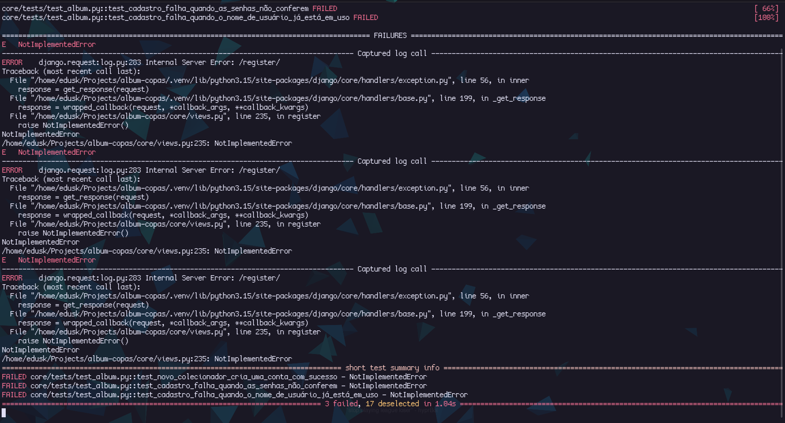
  </figure>
  <figure>
    <figcaption>Fase Green</figcaption>
    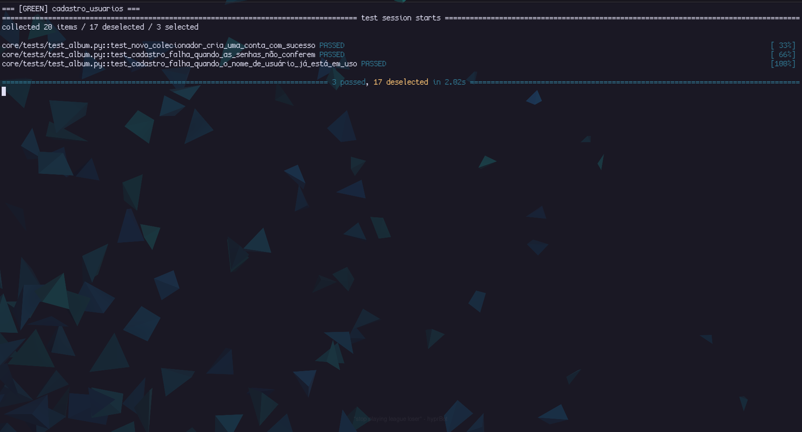
  </figure>
</div>
</div>

<div class="evidence-item">
<h4>2. Autenticação de Usuários</h4>
<div class="evidence-pair">
  <figure>
    <figcaption>Fase Red</figcaption>
    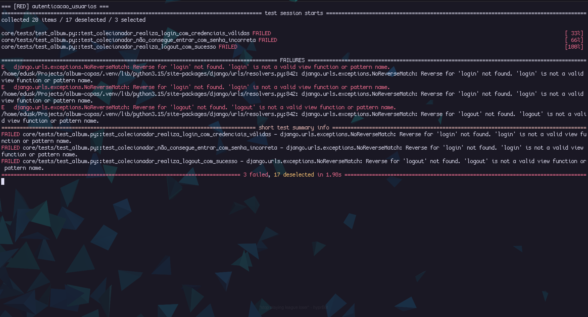
  </figure>
  <figure>
    <figcaption>Fase Green</figcaption>
    
  </figure>
</div>
</div>

<div class="evidence-item">
<h4>3. Adicionar Figurinha</h4>
<div class="evidence-pair">
  <figure>
    <figcaption>Fase Red</figcaption>
    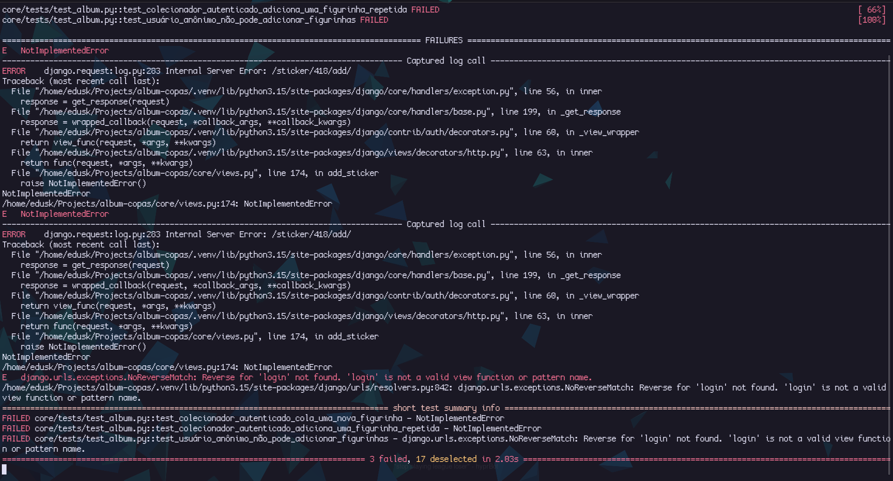
  </figure>
  <figure>
    <figcaption>Fase Green</figcaption>
    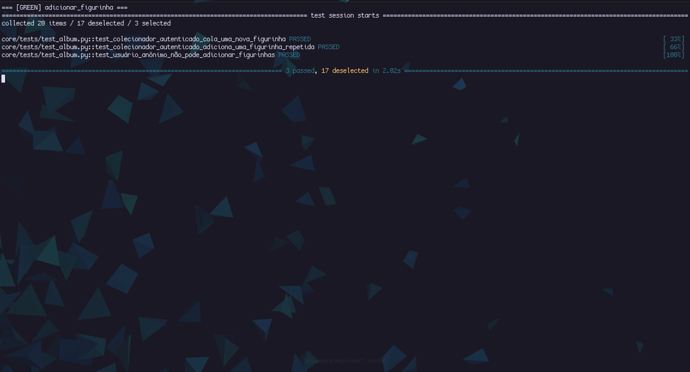
  </figure>
</div>
</div>

<div class="evidence-item">
<h4>4. Barra de Progresso</h4>
<div class="evidence-pair">
  <figure>
    <figcaption>Fase Red</figcaption>
    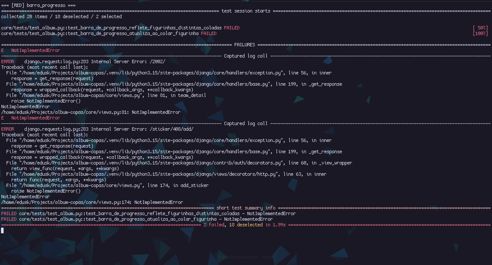
  </figure>
  <figure>
    <figcaption>Fase Green</figcaption>
    
  </figure>
</div>
</div>

<div class="evidence-item">
<h4>5. Detalhes do Jogador</h4>
<div class="evidence-pair">
  <figure>
    <figcaption>Fase Red</figcaption>
    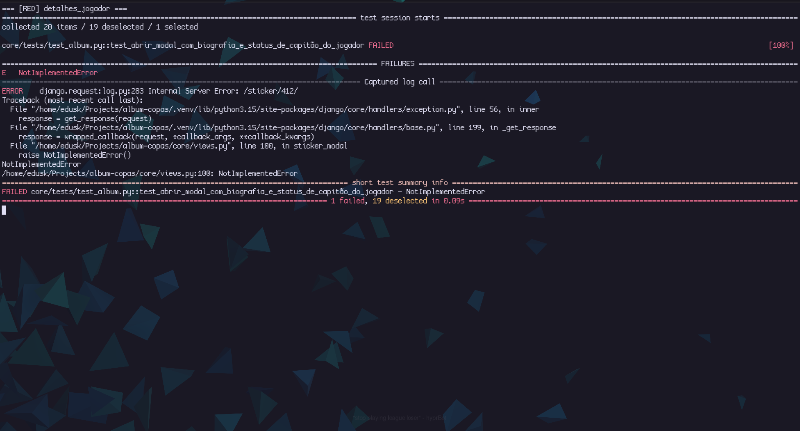
  </figure>
  <figure>
    <figcaption>Fase Green</figcaption>
    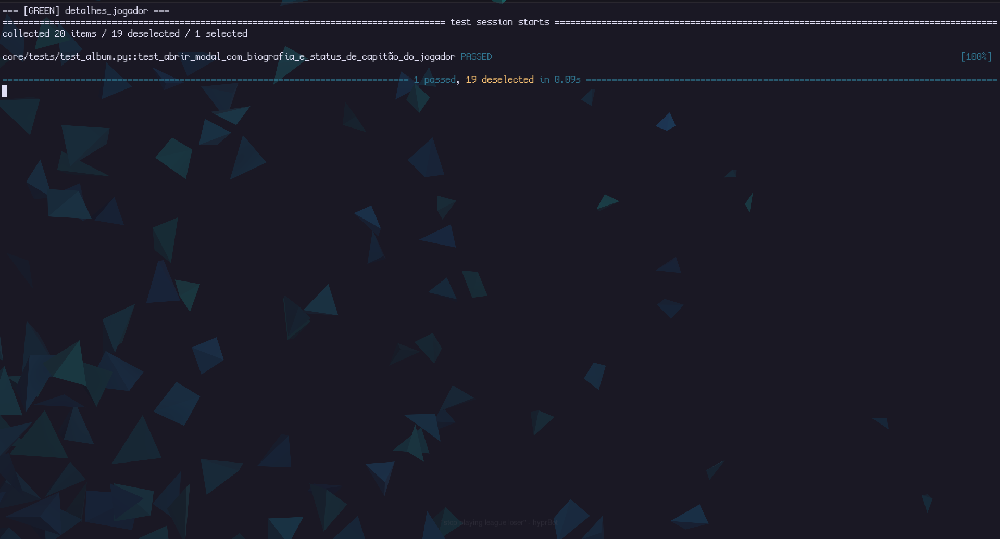
  </figure>
</div>
</div>

<div class="evidence-item">
<h4>6. Pesquisar Figurinha</h4>
<div class="evidence-pair">
  <figure>
    <figcaption>Fase Red</figcaption>
    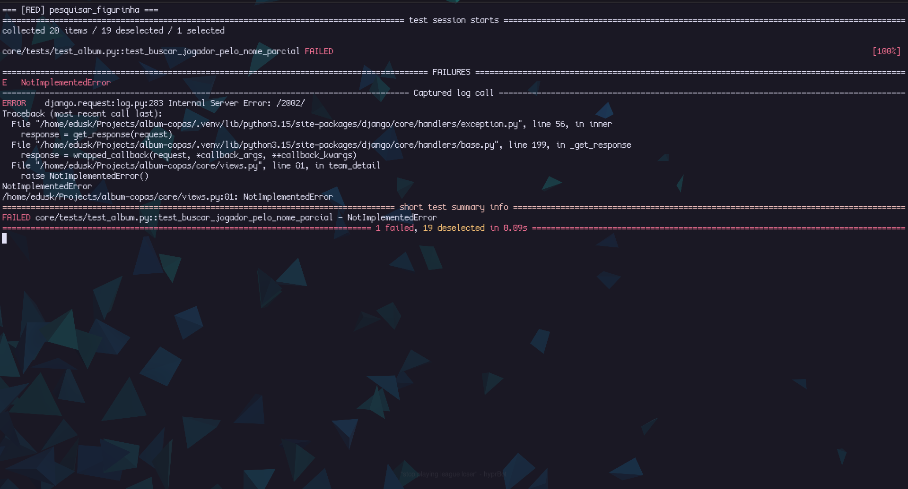
  </figure>
  <figure>
    <figcaption>Fase Green</figcaption>
    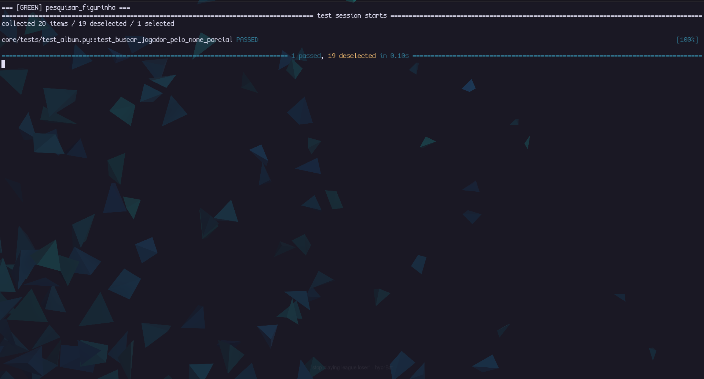
  </figure>
</div>
</div>

<div class="evidence-item">
<h4>7. Filtrar por Posição</h4>
<div class="evidence-pair">
  <figure>
    <figcaption>Fase Red</figcaption>
    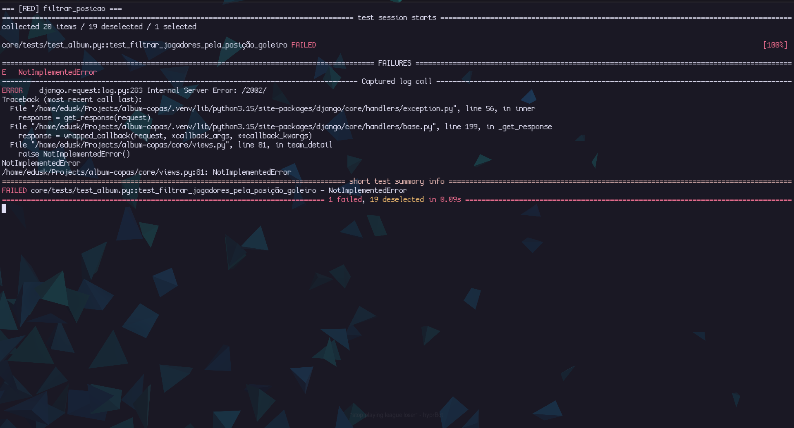
  </figure>
  <figure>
    <figcaption>Fase Green</figcaption>
    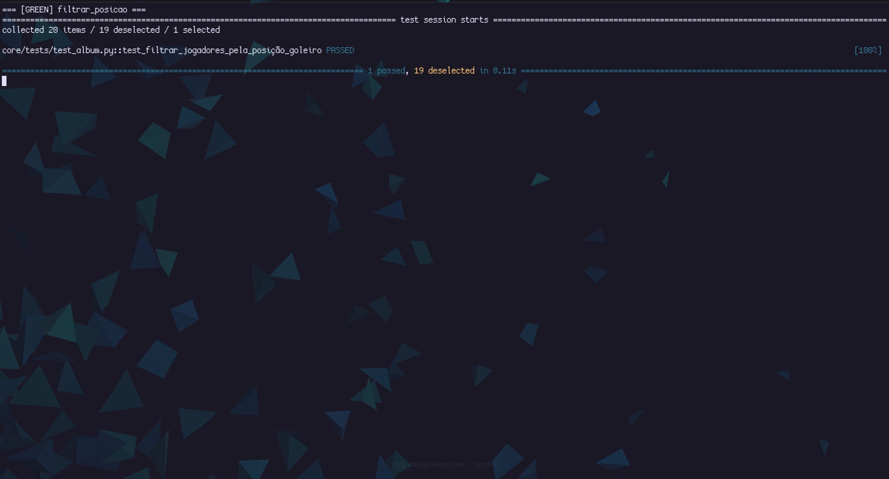
  </figure>
</div>
</div>

<div class="evidence-item">
<h4>8. Filtrar Posse / Repetida</h4>
<div class="evidence-pair">
  <figure>
    <figcaption>Fase Red</figcaption>
    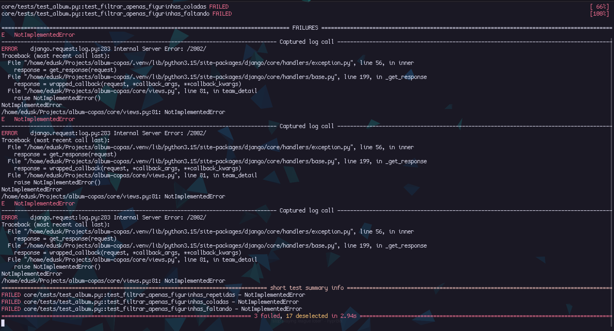
  </figure>
  <figure>
    <figcaption>Fase Green</figcaption>
    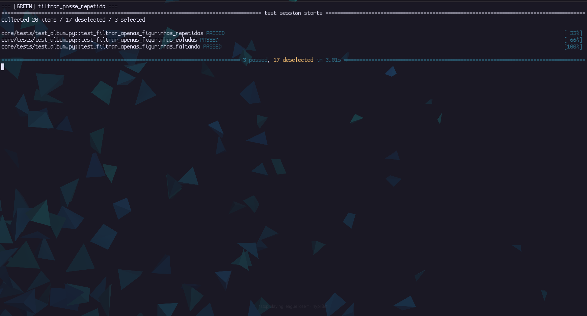
  </figure>
</div>
</div>

<div class="evidence-item">
<h4>9. Ordenar Jogadores</h4>
<div class="evidence-pair">
  <figure>
    <figcaption>Fase Red</figcaption>
    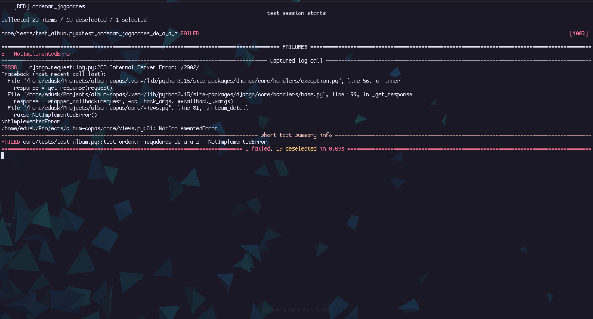
  </figure>
  <figure>
    <figcaption>Fase Green</figcaption>
    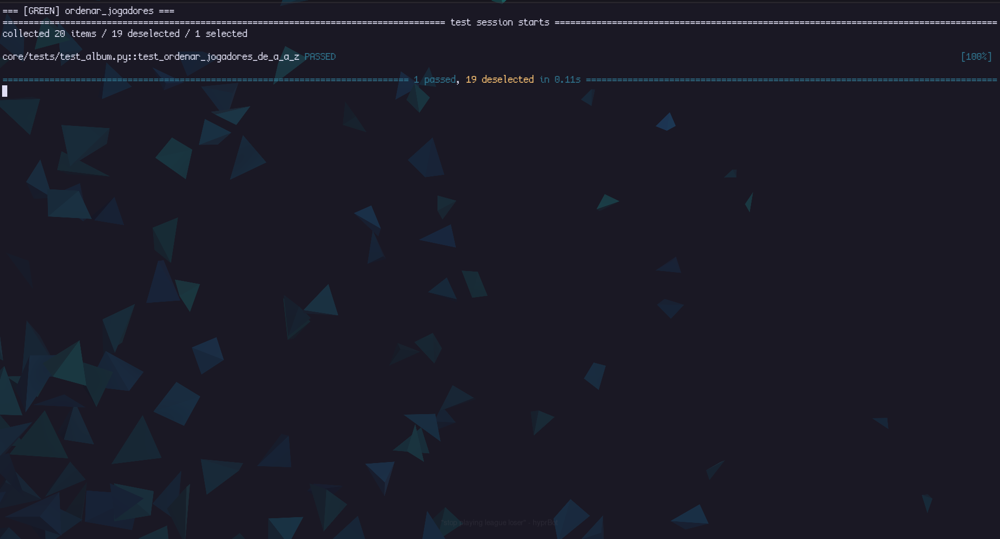
  </figure>
</div>
</div>

<div class="evidence-item">
<h4>10. Lista WhatsApp</h4>
<div class="evidence-pair">
  <figure>
    <figcaption>Fase Red</figcaption>
    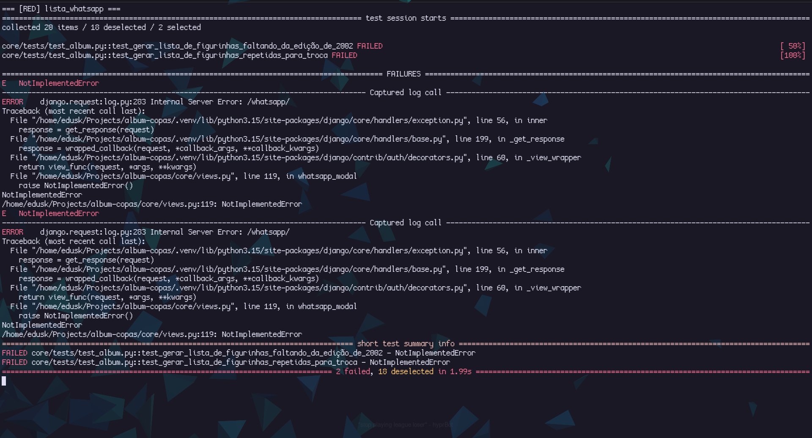
  </figure>
  <figure>
    <figcaption>Fase Green</figcaption>
    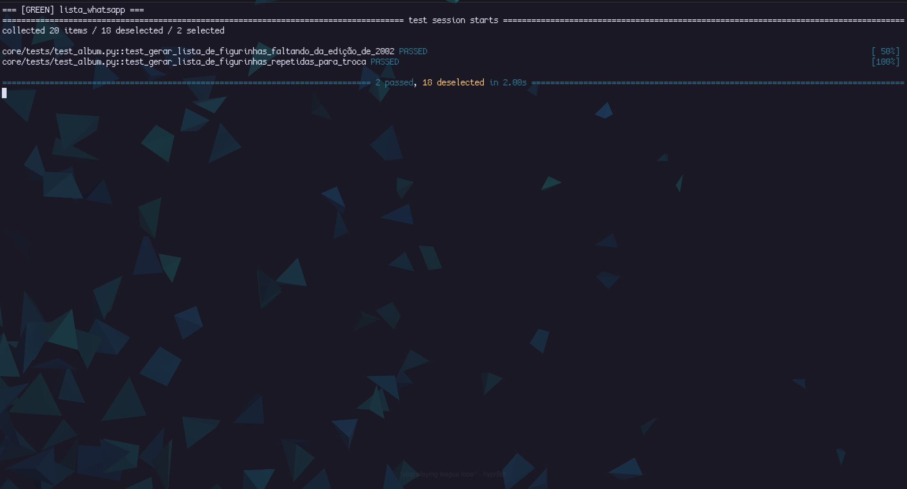
  </figure>
</div>
</div>

</div>
